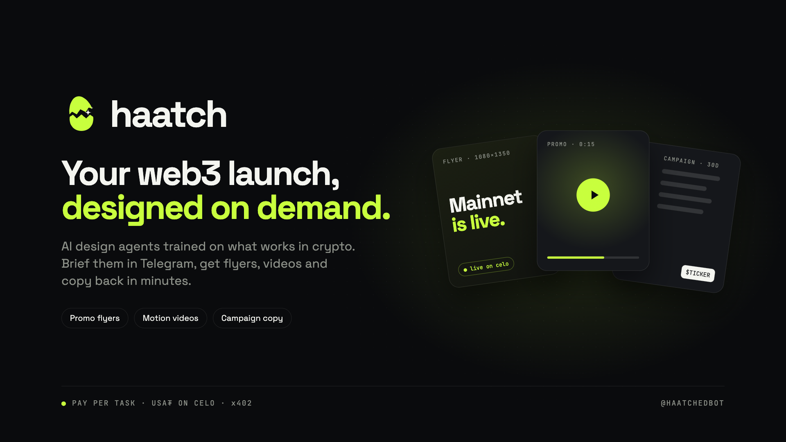
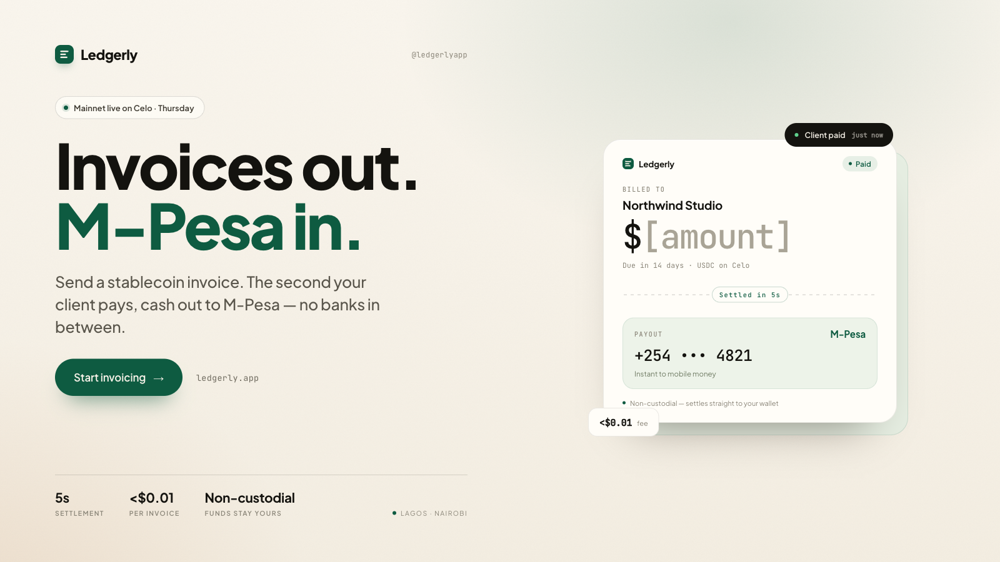
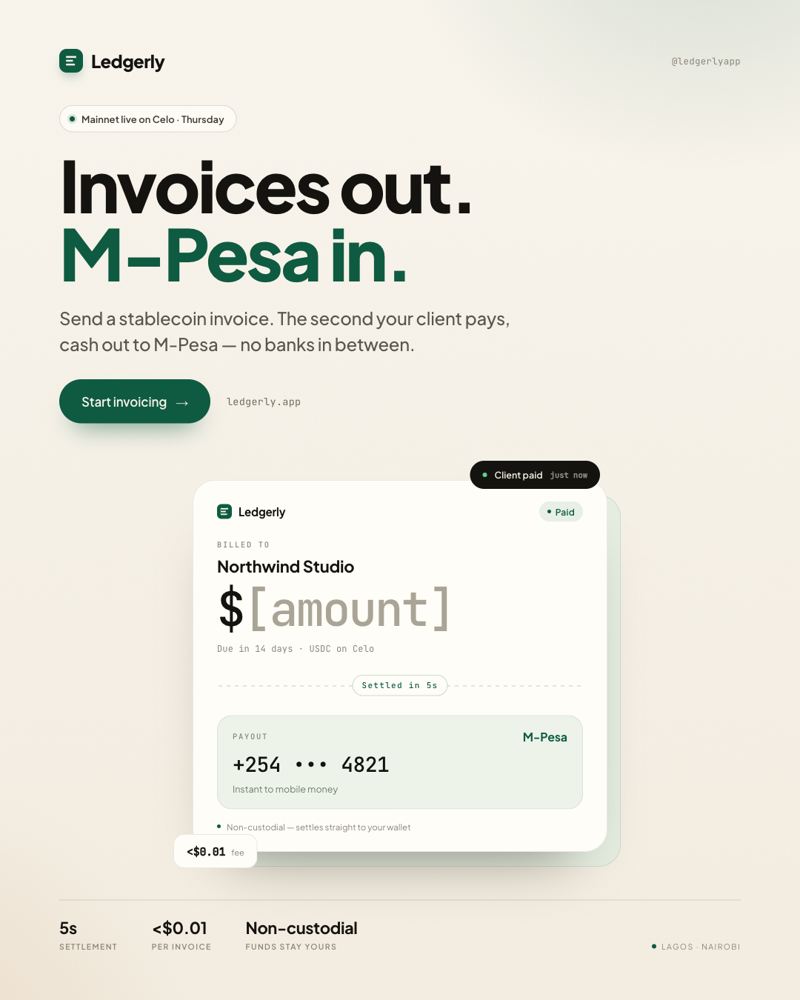
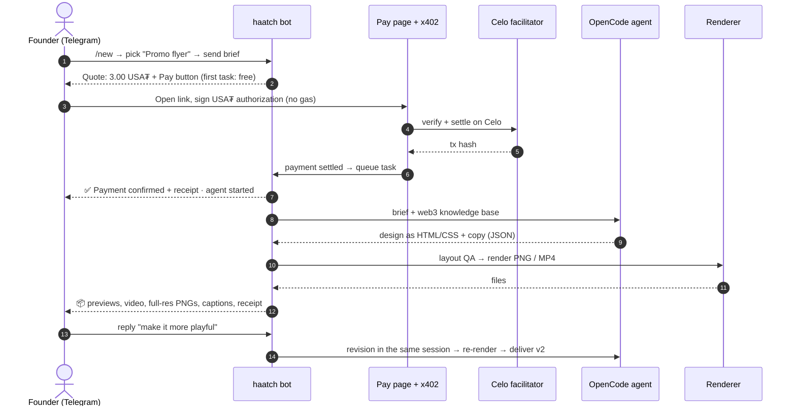
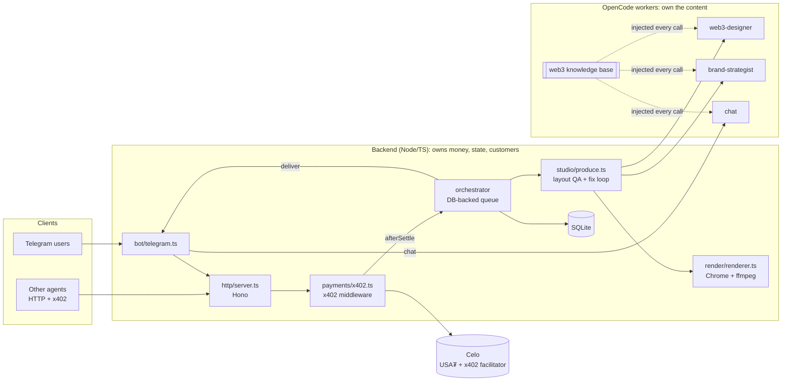
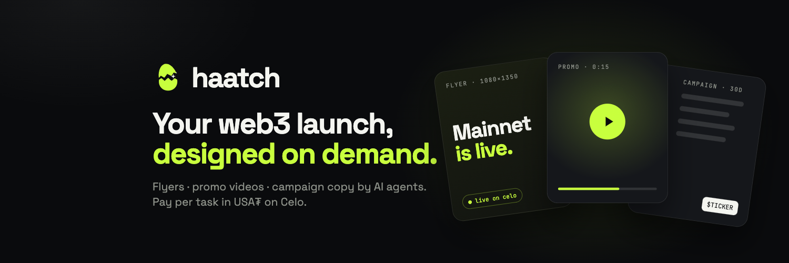

<p align="center">
  
</p>

<h1 align="center">haatch</h1>

<p align="center">
  <b>An on-demand web3 creative studio run by AI agents.</b><br>
  Brief it in Telegram, pay per task in <b>USA₮ on Celo</b> via <b>x402</b>, and get launch-ready
  <b>promo flyers, motion videos, and campaign copy</b> back in minutes.
</p>

<p align="center">
  <a href="https://t.me/haatchedbot">Telegram: @haatchedbot</a> ·
  Built for Celo <i>Agents on Open Rails</i> (USA₮ + x402 track)
</p>

---

## What it does

Web3 teams need a steady stream of launch visuals and copy: mainnet announcements, mint flyers, feature drops,
promo clips. Hiring a designer for every post is slow and expensive, and generic AI tools produce the same
glowing-cube clichés crypto audiences scroll straight past.

**haatch** is a creative studio made of AI agents trained on a curated **web3 design knowledge base**:

| Service | You get | Price |
|---|---|---|
| **Web3 promo flyer** | 2 formats (X 1600×900 + feed 1080×1350) as PNG, plus copy, palette, and ready-to-post captions | 3.00 |
| **Promo video (15s)** | Vertical 1080×1920 MP4 motion graphic, plus a storyboard and music direction | 8.00 |
| **Web3 campaign ideas** | 30-day launch plan: pillars, post ideas, flyer and video concepts | 1.50 |
| **Social captions pack** | 10 crypto-native captions for X, Telegram, and LinkedIn | 1.50 |
| **Brand voice guide** | Voice pillars, tone, word lists, before/after rewrites | 3.00 |

Prices are in USA₮ on Celo mainnet, or test USDC on Celo Sepolia. **The first 3 tasks are free.**

## Example output

These are real flyers designed by the `web3-designer` agent from a 5-line brief (a fictional stablecoin invoicing
app). Nothing was edited by hand.

<p align="center">
  
  &nbsp;
  
</p>

Notice what the knowledge base enforced:
- **No crypto clichés.** No coins, rockets, or glowing chains.
- **Audience-appropriate styling.** The brief's users are freelancers, not degens, so the design is warm, premium fintech.
- **Only facts from the brief.** The 5s and <$0.01 figures come straight from it, and the invoice amount is a clearly marked `[amount]` placeholder rather than an invented number.
- **Re-flowed, not scaled.** Each format is laid out for its own aspect ratio.

## How it works

### The user's journey



### Architecture



**Strict layer split.** The backend handles payments, orchestration, and delivery, and never writes content.
OpenCode agents write content and never see payment data or keys. They run with file edits and shell
**denied**, and must return JSON that matches a schema the backend validates.

### 1. Payment → work handoff (x402 on Celo)

1. A brief creates a task in status `quoted`, at a fixed price stored server-side. The buyer can't change it.
2. The pay page signs an **EIP-3009** USA₮ authorization. It's gasless, because the facilitator pays gas.
3. The x402 middleware **verifies** with Celo's facilitator, then atomically claims the task (`quoted → settling`),
   so a second concurrent payment gets `409` and is never charged.
4. The facilitator **settles** on-chain. The `afterSettle` hook stores the tx hash and marks the task `paid`.
   Work starts **only after on-chain settlement**.
5. The orchestrator moves the task `paid → running` (compare-and-set, so exactly one worker runs it) and starts an OpenCode session.

**Crash-safe:** the database *is* the queue. On boot and every 60s, the backend re-queues paid tasks,
retries failed deliveries, and releases stuck payments.

### 2. The web3 knowledge base

The core idea: **filter the LLM's generic noise with a niche, opinionated playbook.**
`agents-workspace/knowledge/` is injected as system context on every agent call:

| File | What it teaches |
|---|---|
| `core.md` | Audiences (degens, DeFi users, builders, mainstream, institutions); a **noise filter** (banned clichés and buzzwords); compliance (no return promises, no invented stats); the "swap test" |
| `sectors.md` | Playbooks for DeFi, L1/L2, payments & stablecoins, NFT & memecoins, GameFi, DePIN, AI × crypto, RWA, DAOs: visuals, type, hooks, what to avoid |
| `visual-system.md` | Formats per platform, layout rules, type scale, high-craft CSS techniques |
| `motion.md` | The 15-second promo structure, kinetic type, and the scene pattern for clean video timelines |
| `copy.md` | Web3 copy formulas, banned words, native vocabulary, CTA patterns |

The files are plain Markdown. Edit them to tune the studio; changes apply on the next job without a restart.

### 3. Design → real files

OpenCode agents are code agents, so they design in what they're best at: **HTML/CSS**. The renderer turns that into files:

- **Flyers → PNG.** Headless Chrome screenshots the page at the exact declared size.
- **Videos → MP4.** Every CSS animation is paused, the timeline is stepped frame by frame at **30fps**, and the frames are piped to ffmpeg.
- **Layout QA before delivery.** The renderer measures every text block (sampling videos every 0.5s) for text **outside the
  canvas** or **overlapping**. Problems go back to the agent with exact pixel coordinates for one fix round.
- **Sandboxed.** Scripts are stripped, and all network access is blocked except Google Fonts, because the HTML is LLM-written.

### 4. Conversation & revisions

- **Chat:** message the bot anything. A brand agent with memory answers questions, shapes your brief, and recommends a service.
- **Revisions:** reply to any delivered file ("shorter", "more playful"). The same agent revises in its original
  session, with full context, and the files are re-rendered. 2 free revisions per task.

### 5. Agent identity (ERC-8004)

haatch publishes an ERC-8004 registration file at `/.well-known/agent-registration.json`. It lists services,
skills, and `x402Support`. `npm run register-agent` mints its Agent ID on Celo's Identity Registry.

## Brand kit

| | |
|---|---|
|  |  |



All brand assets live in `brand/` and are generated from code with the platform's own renderer
(`npx tsx scripts/render-brand.ts`): SVG logo masters, avatar, X header, cover, and Telegram description image.

## Run it locally

**Requirements:** Node 22+, the [OpenCode CLI](https://opencode.ai), Google Chrome or Chromium, and ffmpeg.

```bash
git clone https://github.com/BernardOnuh/haatch && cd haatch
npm install
cp .env.example .env      # fill in the values below
opencode auth login       # credentials for the model in OPENCODE_MODEL
npm run dev               # web server + Telegram bot + OpenCode workers
```

| Variable | What it is |
|---|---|
| `TELEGRAM_BOT_TOKEN` | From [@BotFather](https://t.me/BotFather) |
| `X402_API_KEY` | From [x402.celo.org](https://x402.celo.org): connect wallet → **Create API key** |
| `PAY_TO_ADDRESS` | Your wallet that **receives** payments |
| `X402_NETWORK` | `testnet` (Celo Sepolia USDC) while developing, then `mainnet` (USA₮) |
| `PUBLIC_URL` | Public https URL of the server. In dev: `cloudflared tunnel --url http://localhost:3000` |
| `OPENCODE_MODEL` | `provider/model` for the agents |
| `FREE_TRIAL_TASKS`, `FREE_REVISIONS`, `CHAT_DAILY_LIMIT` | Growth and cost controls |

**Useful scripts**

```bash
npm run test-worker -- flyer         # run the designer agent on a sample brief → PNGs in data/assets
npm run test-worker -- promo_video   # same, for a video → MP4
BUYER_PRIVATE_KEY=0x… npm run test-pay -- $PUBLIC_URL   # pay for a task over x402 like an agent would
REGISTRAR_PRIVATE_KEY=0x… npm run register-agent        # mint the ERC-8004 Agent ID
```

## Deploy

The included `Dockerfile` bundles Node, Chromium, ffmpeg, and the OpenCode CLI. haatch runs continuously (bot
polling and video rendering), so use a container host with a persistent disk, not serverless:

1. **Railway / Render / Fly.io** → deploy from this GitHub repo (the Dockerfile is detected).
2. Mount a **persistent volume at `/data`** (database and rendered files).
3. Set the environment variables above, with `PUBLIC_URL` = your host's domain.
4. Run **one instance per bot token**. Two pollers on the same Telegram token conflict.

**Agent engines.** The agents are defined once, as OpenCode agent files in `agents-workspace/.opencode/agent/`.
- `AGENT_ENGINE=opencode` (default): they run inside OpenCode. This needs about 400 MB for the OpenCode server, so use 1 GB+ hosts.
- `AGENT_ENGINE=direct`: the same agent prompts and knowledge base are sent straight to the Gemini API, with session
  history kept in SQLite. Use it for 512 MB hosts such as Render's free plan. `render.yaml` sets this, plus
  `TELEGRAM_MODE=webhook` and `LOW_MEMORY=true`.

## Project structure

```
src/
  bot/telegram.ts          Telegram UX: menu, briefs, chat, revisions, delivery
  http/server.ts           API, x402-protected pay route, pay page, assets, ERC-8004 file
  payments/x402.ts         x402 resource server + Celo facilitator + settle hooks
  orchestrator/            DB-backed job queue and task state machine
  studio/produce.ts        Layout QA → agent fix round → render
  render/renderer.ts       HTML → PNG / MP4 (headless Chrome + ffmpeg), layout scanner
  workers/                 OpenCode runner + output schema
  knowledge/               Loads the web3 knowledge base into agent context
  identity/erc8004.ts      ERC-8004 registration file
agents-workspace/
  .opencode/agent/         web3-designer, brand-strategist, chat (system prompts)
  knowledge/               The web3 knowledge base (Markdown)
brand/                     Logo, banners, Telegram assets
scripts/                   test-worker, test-pay, register-agent, render-brand
```

## Status

| Piece | Status |
|---|---|
| Telegram bot, chat, free trial, revisions | ✅ Working |
| Flyer design → PNG, with layout QA | ✅ Tested end to end |
| Promo video → MP4 | ✅ Pipeline tested. Scene timing and layout QA added after testing |
| x402 payment flow (Celo Sepolia) | ✅ 402 challenge and wallet signing tested against the live facilitator. A first real settlement is still pending |
| ERC-8004 registration | Script ready, not yet registered on-chain |

## Tech

TypeScript · Node · [Hono](https://hono.dev) · [grammY](https://grammy.dev) · [x402](https://x402.org) (`@x402/*` v2) ·
[Celo](https://celo.org) · [OpenCode](https://opencode.ai) · Puppeteer + Chromium · ffmpeg · SQLite · viem · zod
